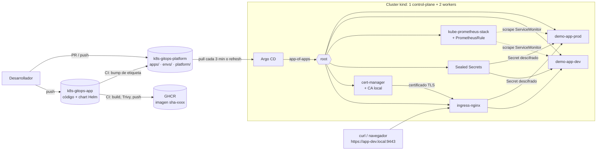

# k8s-gitops-platform

Repositorio **GitOps** de la plataforma: Argo CD (patrón *app-of-apps*) despliega y mantiene en un
cluster Kubernetes local el Ingress con TLS, Sealed Secrets, kube-prometheus-stack y la aplicación de
demostración en dos entornos (dev y prod). Todo el estado deseado vive en Git; el cluster solo lo refleja.

> **Nota honesta:** el plan original hablaba de k3s, pero k3s necesita `sudo` en el host. Todo se ha
> probado sobre **kind** (Kubernetes dentro de Docker, 1 control-plane + 2 workers). Es un laboratorio
> **local**: no hay cloud, ni IP pública, ni DNS real, ni certificados de una CA pública.
> Los entornos dev y prod comparten el mismo cluster (namespaces `demo-dev` y `demo-prod`); en un caso real
> serían clusters distintos.

Repositorio hermano con la aplicación, su chart Helm y el CI de imagen:
[k8s-gitops-app](https://github.com/dgr-devops/k8s-gitops-app).

## Arquitectura



## Estructura

```text
bootstrap/        kind-config.yaml, bootstrap.sh (cluster + Argo CD + app raíz), root-app.yaml
apps/             Una Application de Argo CD por componente (la "app de apps" lee este directorio)
platform/         Manifiestos propios (Kustomize): issuers de cert-manager, reglas de Prometheus, SealedSecrets
envs/dev|prod/    Valores Helm de la aplicación por entorno (réplicas, host, etiqueta de imagen, secreto)
scripts/          seal-secret.sh (cifra un valor con la clave pública del cluster)
docs/             decisiones.md, incidentes-provocados.md
```

Orden de sincronización (*sync waves*): ola 0 (ingress-nginx, cert-manager, sealed-secrets, monitoring) →
ola 1 (issuers, reglas de alertas, secretos) → ola 2 (aplicaciones dev y prod).

## Arranque (bootstrap)

Requisitos: `docker`, `kind`, `kubectl`, `helm`. No hace falta `sudo`.

```bash
# 1. (opcional) construir la imagen en local y cargarla en kind
docker build -t ghcr.io/dgr-devops/k8s-gitops-app:v1.0.0 ../k8s-gitops-app

# 2. crear cluster, instalar Argo CD y aplicar la aplicación raíz
bootstrap/bootstrap.sh

# 3. esperar a que todo esté Synced/Healthy
kubectl -n argocd get applications -w
```

Acceso a la aplicación (puertos 9080/9443 del host, sin tocar `/etc/hosts`):

```bash
kubectl -n cert-manager get secret local-ca-secret -o jsonpath='{.data.ca\.crt}' | base64 -d > ca.crt
curl --cacert ca.crt --resolve app-dev.local:9443:127.0.0.1 https://app-dev.local:9443/
curl --cacert ca.crt --resolve app-prod.local:9443:127.0.0.1 https://app-prod.local:9443/
```

Secretos sellados: `printf '%s' 'valor' | scripts/seal-secret.sh demo-dev demo-app-secret APP_SECRET platform/secrets/sealed-demo-app-dev.yaml`
y commit del YAML resultante. La **clave privada del controlador nunca va a Git** (`.secrets/` está en
`.gitignore`); si se recrea el cluster, `bootstrap.sh` restaura la copia local para que los SealedSecret
ya commiteados sigan descifrándose. Sin esa copia hay que volver a sellarlos.

## Qué se verificó (ejecutado de verdad)

Cluster kind `gitops` (Kubernetes v1.37.0, 3 nodos), Argo CD 3.6 leyendo **directamente de los repos
públicos de GitHub**:

```text
$ kubectl -n argocd get applications
NAME                   SYNC STATUS   HEALTH STATUS
cert-manager           Synced        Healthy
cert-manager-issuers   Synced        Healthy
demo-app-dev           Synced        Healthy
demo-app-prod          Synced        Healthy
ingress-nginx          Synced        Healthy
monitoring             Synced        Healthy
monitoring-rules       Synced        Healthy
root                   Synced        Healthy
sealed-secrets         Synced        Healthy
secrets                Synced        Healthy
```

- **Ingress con TLS:** cert-manager emite `demo-app-tls` en cada namespace con la CA local
  (`CN=gitops-local-ca`); `curl --cacert ca.crt https://app-dev.local:9443/` responde `200` con
  `ssl_verify=0` (cadena verificada) y devuelve `"message": "Hola desde dev"`; prod, `"Hola desde prod"`.
- **Sealed Secrets:** se selló `APP_SECRET` para `demo-dev` y `demo-prod`, se hizo commit del YAML cifrado,
  Argo CD lo sincronizó y el controlador generó el `Secret` (23 bytes descifrados); la app pasó a
  responder `"secret_configured": true`.
- **Prometheus:** 25 objetivos `up` (apiserver, kubelet, coredns, node-exporter, kube-state-metrics y
  los `ServiceMonitor` de `demo-app-dev` y `demo-app-prod`).
- **Alertas propias:** `DemoAppUnavailable`, `DemoAppPodNotReady` y `DemoAppOOMKilled`
  (`platform/monitoring-rules/demo-app-rules.yaml`); se vieron **disparadas** en Alertmanager durante los
  incidentes.
- **6 incidentes provocados** con diagnóstico y arreglo reales: ver
  [docs/incidentes-provocados.md](docs/incidentes-provocados.md).
- **CI en GitHub:** yamllint, `kubectl kustomize`, kubeconform, `helm lint`/`template` con los valores de
  cada entorno y ShellCheck (workflow reutilizable de
  [github-actions-reusable-workflows](https://github.com/dgr-devops/github-actions-reusable-workflows)).

## Qué NO se verificó / límites

- La imagen no se descarga de GHCR en el cluster: se **carga con `kind load`** desde Docker local, porque
  el paquete de GHCR nace privado y cambiar su visibilidad es un paso manual en la web. La publicación en
  GHCR la hace el CI del repo de la app (ver su README).
- El *bump* automático de etiqueta entre repos necesita un secreto `GITOPS_TOKEN` (PAT con permiso de
  escritura en este repo) que no está configurado; sin él, ese paso se omite con un aviso.
- Dev y prod comparten cluster; no hay aislamiento real entre entornos ni RBAC por entorno.
- Alertmanager no tiene receptores (email/Slack): las alertas solo se ven en su API/UI.
- Grafana está desactivado para ahorrar recursos; los objetivos *etcd*, *scheduler*, *controller-manager*
  y *kube-proxy* están desactivados porque en kind solo escuchan en localhost.
- No se probó en otra máquina ni con k3s.

## Más información

- [docs/decisiones.md](docs/decisiones.md): por qué cada elección.
- [docs/incidentes-provocados.md](docs/incidentes-provocados.md): incidentes reales, con diagnóstico.

Licencia: MIT.
